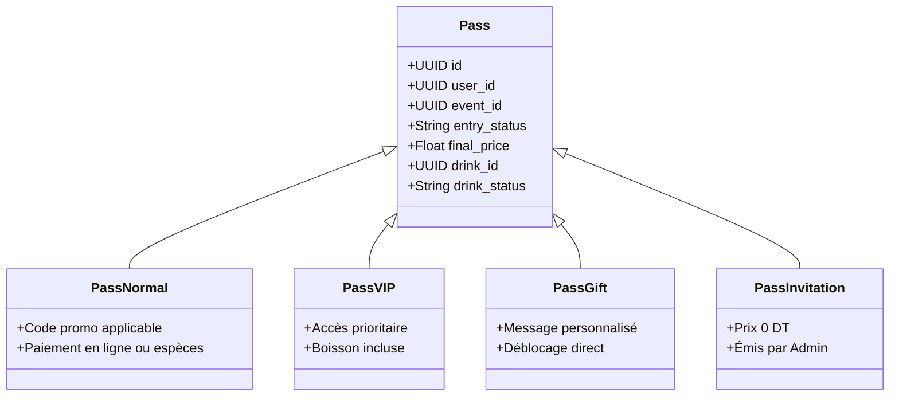

# PASSI — Cahier des Charges Fonctionnel

> **Version du document :** 1.0.0  
> **Date de référence :** Octobre 2026  
> **Statut :** Spécification Officielle de Production  

---

## 1. Introduction & Vision du Projet

**PASSI** est une plateforme SaaS événementielle haut de gamme conçue pour révolutionner la gestion des accès et des consommations lors d'événements exclusifs (festivals, clubs, soirées privées).  
La solution combine une application web progressive (PWA) fluide pour les festivaliers, une interface de caisse décentralisée pour les points de paiement physiques, des scanners QR autonomes pour le staff opérationnel (sécurité et barman), et un panneau d'administration centralisé pour les organisateurs.

### 1.1 Objectifs Clés
* **Élimination de la fraude** : Billetterie sécurisée avec double QR Code distinct (Accès événementiel vs Consommation au bar).
* **Parcours de paiement hybride** : Réservation en ligne avec règlement en espèces dans des points de vente physiques agréés, sans dépendre exclusivement des passerelles bancaires traditionnelles.
* **Vérification d'identité sociale** : Liaison obligatoire avec le profil Instagram pour assurer la sélectivité et la conformité des participants.
* **Sécurité & Immutabilité** : Triggers de base de données garantissant l'intégrité financière des billets payés et limitation des attaques par force brute (Rate Limiting).

---

## 2. Acteurs du Système & Matrice des Rôles

Le système PASSI structure ses accès autour de 5 profils distincts :

| Rôle | Périmètre d'accès | Fonctionnalités Clés |
| :--- | :--- | :--- |
| **User (Client / Festivalier)** | Public / Espace Client (`/dashboard`, `/catalogue`) | Découverte du catalogue, réservation de pass, sélection asynchrone des boissons, affichage des QR codes dynamiques, complétion du profil. |
| **Payment Point (Point de Paiement)** | Guichet Dédié (`/payment-point/dashboard`) | Recherche rapide des pass en attente de paiement, encaissement des espèces, validation du pass, suivi de caisse personnel en temps réel. |
| **Security (Agent de Sécurité)** | Contrôle d'Accès (`/scanner/security`) | Scan du QR Code d'entrée, vérification instantanée du statut et de l'identité, blocage des doublons ou pass non réglés. |
| **Barman (Service des Consommations)** | Bar Opérationnel (`/scanner/barman`) | Scan du QR Code boisson, validation de la délivrance de la consommation choisie, décompte unitaire anti-réutilisation. |
| **Admin (Super Administrateur)** | Console Globale (`/admin`) | Gestion totale des événements, création de pass spéciaux (VIP/Cadeaux/Invitations), approbations/rejets, exports comptables, suppression contrôlée. |

---

## 3. Spécifications Détaillées des Parcours Utilisateurs

### 3.1 Authentification & Onboarding d'Identité

```mermaid
graph TD
    A[Visiteur sur /login] --> B{Choix Auth}
    B -->|OAuth Social| C[Google / Meta Instagram / Facebook]
    B -->|Email / Mot de passe| D[Validation des identifiants]
    C --> E[/api/auth/rate-limit]
    D --> E
    E -->|Tentatives <= 10/24h| F[Connexion Supabase Auth]
    E -->|Tentatives > 10/24h| G[Blocage HTTP 429: Réessayer demain]
    F --> H{Profil complet ?}
    H -->|instagram_handle présent| I[Accès /dashboard]
    H -->|instagram_handle absent| J[Modal Bloquant Onboarding Instagram]
    J -->|URL Instagram validée| I
```

1. **Sélection du mode de connexion** :
   * **Connexion Sociale (OAuth 2.0)** : Google, Facebook et Instagram avec redirection automatique vers le tableau de bord sans écran intermédiaire.
   * **Email / Mot de passe classique** : Avec lien de réinitialisation sécurisé en cas d'oubli.
2. **Contrôle Anti-Brute-Force (Rate Limiting)** :
   * Limitation stricte à **10 tentatives de connexion par fenêtre glissante de 24 heures** par adresse IP et par compte email.
   * Affichage d'un toast d'erreur explicite en cas de dépassement : *"Trop de tentatives. Veuillez réessayer demain."*.
3. **Persistance de Session** :
   * Configuration de session longue durée (`persistSession: true`) basée sur des cookies HTTP sécurisés permettant au festivalier de rester connecté sans interruption pendant l'événement.
4. **Vérification Obligatoire Instagram** :
   * Tout compte créé via Google ou email dont le lien Instagram est vierge est intercepté par une fenêtre modale bloquante (`CompleteProfileModal`) exigeant une URL Instagram valide (format `https://instagram.com/pseudo`).

---

### 3.2 Réservation & Typologie des Pass

La plateforme gère quatre familles distinctes de pass :



1. **Pass Standard (Normal)** :
   * Sélection de l'événement et du nombre de places.
   * Option de choix immédiat de la boisson ou différé.
   * Calcul en temps réel du tarif : `Prix de Base + Supplément Boisson - Réduction Code Promo`.
   * Statut initial : `pending` (en attente d'approbation) ou `awaiting_payment` (en attente de règlement au guichet).
2. **Pass VIP** :
   * Billet premium avec avantages coupe-file et boisson haut de gamme intégrée.
3. **Pass Cadeau (Gift)** :
   * Achat destiné à un proche : saisie des nom, prénom et message personnalisé de l'acheteur. Déverrouillage automatique.
4. **Pass Invitation (Staff / Partenaire)** :
   * Émis directement via l'espace d'administration (`/admin/passes/create`). Ne nécessite aucun paiement physique, directement finalisé au statut `activated`.

---

### 3.3 Architecture Dual-QR Code (Accès vs Boisson)

Chaque pass possède deux flux de validation indépendants matérialisés par deux QR Codes visuellement distincts :

```
┌─────────────────────────────────────────────────────────────┐
│                      BILLET PASSI                           │
│                                                             │
│   [ QR CODE ENTRÉE ]                 [ QR CODE BOISSON ]    │
│   • UUID d'accès                     • UUID de consommation │
│   • Statut : activated / scanned     • Statut : available   │
│   • Scanné par : SÉCURITÉ            • Scanné par : BARMAN  │
└─────────────────────────────────────────────────────────────┘
```

* **QR Code Entrée** :
  * Déverrouillé uniquement après confirmation du paiement (`entry_status = 'activated'`).
  * Scanné par l'agent de sécurité via `/scanner/security`. Dès validation, il passe à `'scanned'`.
  * Tout scan subséquent est rejeté avec alerte rouge sonore et visuelle.
* **QR Code Boisson (Asynchrone)** :
  * Si l'utilisateur n'a pas sélectionné sa boisson lors de l'achat, le système affiche un bouton d'action *"Choisir ma boisson"*.
  * Dès la boisson choisie, un QR Code dédié est généré.
  * Le barman le scanne via `/scanner/barman` : le système valide le nom exact de la boisson à servir et bascule le statut en `'claimed'`.

---

### 3.4 Encaissement physique aux Points de Paiement

1. Le client se présente au guichet physique muni de sa référence de pass, de son email ou de son pseudo Instagram.
2. L'opérateur de caisse tape la recherche dans l'interface dédiée (`/payment-point/dashboard`).
3. La fiche du pass s'affiche avec le montant exact à percevoir (tenant compte des remises promo).
4. L'opérateur valide l'encaissement en espèces :
   * Le pass passe instantanément de `awaiting_payment` à `activated`.
   * Une transaction est enregistrée au nom de l'agent de caisse (horodatage, montant, identifiant de l'agent).
   * Le client voit son pass s'activer en direct sans recharger la page.

---

## 4. Règles de Gestion & Intégrité des Données

### RG-01 : Immutabilité des Billets Payés
* Tout pass dont le statut d'entrée est `'activated'` ou `'scanned'` est **strictement immutable**.
* Un trigger PostgreSQL (`prevent_paid_pass_modification`) bloque toute mise à jour du prix (`final_price`), de l'acheteur (`user_id`), ou de l'événement associé, empêchant les fraudes internes ou altérations d'historique comptable.

### RG-02 : Suppression Automatique des Rejets (Cycle 48h)
* Les demandes de pass rejetées par l'administration (`entry_status = 'rejected'`) sont conservées pendant **48 heures** pour information et traçabilité du client.
* Au-delà de 48 heures, les pass rejetés sont automatiquement masqués des vues opérationnelles et purgés de la base de données.

### RG-03 : Suppression Administrative Sécurisée (Confirmation Nominative)
* Un administrateur peut supprimer définitivement un pass erroné ou frauduleux.
* **Sécurité renforcée** : Pour valider la suppression, l'administrateur **doit obligatoirement saisir le nom exact du titulaire du pass**. Le système normalise les espaces et la casse avant d'autoriser l'action destructrice.

### RG-04 : Déconnexion et Rôles Séparés
* Les interfaces de scan (`/scanner/security`, `/scanner/barman`) et de caisse (`/payment-point`) sont isolées par rôle. Les agents opérationnels ne disposent d'aucun accès aux réglages de la billetterie ni aux chiffres d'affaires globaux.
